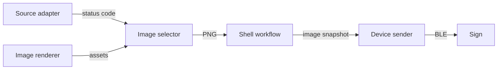

# Architecture

This document defines design principles and contracts. See the [README](../README.md) for setup, commands, and workflow
recipes, the [implementation plan](implementation-plan.md) for progress and acceptance criteria, and the
[protocol](protocol.md) for verified device behavior.

## Composition and boundaries

Each leaf command performs one operation and exits. Domain groups organize discovery while preserving Unix pipe
composition. Keep CLI parsing separate from domain operations, and inject side-effecting dependencies.

Source adapters own requests and domain-specific interpretation. Selectors own exact code-to-asset mappings; renderers
own image construction. The sender owns image validation, encoding, and device transfer. These operations remain
independent of one another's domains.

Provider summary validation is separate from user policy. GitHub's indicator is the default output;
an explicit `--policy FILE` selects typed TOML settings for optional service classification.
Policy files require an explicit mode; service mode also requires priority service IDs, an outage threshold, and all codes.
Indicator policies accept no service settings. The [static Actions policy](../data/github-actions.toml) supplies a complete
example, selected only by its explicit path. No policy is discovered from global files or the environment.

Scheduling, comparisons, persistence, and locks belong in Unix shell composition. Commands do not embed a job manager.
Python and testing conventions are defined in [the contributor guidelines](../AGENTS.md).

## Stream and failure contracts

- Sources emit one stable code and a newline on stdout. Unknown or incomplete data fails rather than implying health.
- Selectors consume one exact code from stdin and emit the selected PNG's original bytes. Asset paths resolve relative
  to the explicit mapping file. Selected cards must be static 1280 x 720 PNGs. Lookup, read, or validation failures
  produce no image output.
- Renderers produce deterministic static 1280 x 720 grayscale PNG bytes or write an explicitly named output file.
  Rendering completes before output begins; invalid inputs produce no image and preserve an existing output file.
  Artwork and TOML layout templates are explicit inputs; visible text requires an explicit font.
  Layouts declare nonoverlapping canvas boxes, vertical alignment, and text typography. Text blocks are optional.
  Text inset advice is device-specific; artwork may reach canvas edges. Pillow owns text wrapping and multiline layout.
  Rendering has no source interpretation or scheduling state.
- The sender validates the complete input before prompting or scanning Bluetooth. PNG stdin must be static and
  1280 x 720; file inputs retain the image formats supported by the sender.
- Data belongs on stdout; progress, prompts, and errors belong on stderr.
- Nonzero exit indicates failure. Successful transfer calls do not establish physical display acknowledgement;
  see [the protocol's observed limits](protocol.md).

## Workflow state

Keep workflow artifacts in an explicitly selected state directory:

| Artifact | Meaning |
| --- | --- |
| `pending.png` | Latest complete desired image selected from the source |
| `last-sent.png` | Exact image whose transfer calls last completed successfully |

Publish pending images through a temporary file beside the destination and an atomic rename, only when bytes differ.
Failed fetches, selections, or renders preserve the previous pending image. Identical source states select identical
prebuilt assets; rendered output should change with meaningful source data rather than polling timestamps.

An uploader snapshots the pending image and sends only when that snapshot differs from last-sent. Advance last-sent only
to that snapshot after successful transfer calls. A newer pending image published during transfer remains available for
the next upload.
A source that recovers before upload may select the already-sent image, making an upload unnecessary.

Allow only one poller and one uploader per workflow/device, using scheduler supervision or Unix locks. Define stale-data
behavior before unattended use. The [README workflow recipes](../README.md#github-workflow) apply these contracts;
remaining integration work is tracked in the [implementation plan](implementation-plan.md#workflow-acceptance).

## Button prompts and desktop integration

The terminal prompt is the primary interface while uploads require a physical button press. Prompt after validation and
before discovery, so the person knows when to wake the sign.

An optional desktop helper observes local workflow state and invokes the same upload operation. It can distinguish
up-to-date, update-pending, waiting-for-button, sending, completed, and failed states. It owns presentation rather than
source interpretation, image construction, scheduling, or the BLE protocol. Completion describes transfer calls;
physical display confirmation remains separate.

Scheduler installation, background helpers, and desktop notifications require explicit setup. They are not side effects
of installing or invoking an ordinary command. Convenience options are tracked in the
[implementation plan](implementation-plan.md#optional-desktop-and-rendering-work).
