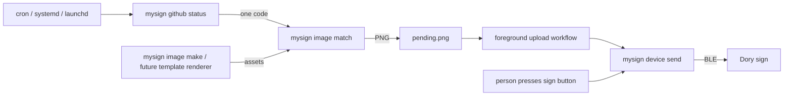

# Architecture

The project follows Unix composition: domain adapters emit status codes, selectors choose images, renderers build images,
and the sender transfers an image. Scheduling and workflow state are documented shell operations.
The first workflow shows GitHub's overall status with one of four prebuilt PNGs.

## Tool boundaries

| Tool | Owns | Does not own | Implementation state |
| --- | --- | --- | --- |
| `mysign github status` | Request, GitHub JSON interpretation, stable rollup code | Images, Bluetooth, scheduling | WIP |
| `mysign image match` | Exact code lookup and asset reading | Endpoint knowledge, rendering, workflow persistence | WIP |
| `mysign image make` | Building a PNG using appearance inputs | Fetching status or sending to hardware | WIP |
| `mysign device send` | Dimension validation, encoding, BLE discovery/transfer, terminal prompt | GitHub, polling, pending-image persistence | File input works; stdin WIP |
| `mysign image test-card` | Recognizable diagnostic image and ID metadata | General layout authoring | Working |

The packaged `mysign device scan` command is a device discovery aid.
Investigation scripts live separately from the public tools.

The commands use Click domain groups under one `mysign` executable. Leaf flags and defaults are preserved from the
initial argparse interface. Click supplies help and usage-error formatting.

## Stream and failure contracts

- A source emits exactly one stable code and a newline on stdout, such as `minor`.
- A selector consumes one exact code from stdin and emits PNG bytes on stdout. Configuration is explicit; asset paths
  resolve relative to the mapping file. Unknown codes fail instead of falling back to a healthy image.
- Renderers emit PNG bytes, or write an explicitly named output file. Future templates preserve that image interface.
- The sender currently accepts `--image FILE` or `--frame FILE`. Planned `--image -` consumes PNG bytes from stdin.
- Progress and errors go to stderr. The scanner's discovered-device records remain stdout data.
- Nonzero exit indicates failure. Fetch and mapping errors do not produce a new pending image. A zero sender exit does
  not imply a physical display acknowledgement; that distinction is recorded in [the protocol](protocol.md).

Each leaf command does one operation and exits. Grouping organizes discovery while preserving Unix pipe composition.
Vendor-specific logic remains separate from image selection and rendering.
Use Pydantic models for new structured configuration, with immutable data and serialization owned by the model.
Closed domain sets, such as GitHub's four indicator codes, use `StrEnum` in Python adapters.

## Existing Python structure

- Python sources are under `src/greg_mitchell/pwn_my_sign/`.
- `cli/mysign.py` defines the single installed executable, declared in `pyproject.toml`.
  `cli/device.py` and `cli/image.py` register domain groups; `cli/scan.py`, `cli/send.py`, and `cli/test_card.py`
  define their leaf commands. The `github` group is planned with the source adapter.
- `device/operations.py` owns discovery and upload orchestration, with injected Bluetooth dependencies.
- `images/test_card.py` builds the diagnostic image. Keep image construction separate from CLI options and file output.
- `frame_codec.py` and `transport.py` retain the verified image format and BLE transfer implementation.
- Tests mirror the package under `tests/greg_mitchell/pwn_my_sign/`. 
- Public fixtures build test patterns. Do not redistribute proprietary images as fixtures.

## Workflow state

Keep two image artifacts in an explicitly selected state directory:

| Artifact | Meaning |
| --- | --- |
| `pending.png` | Latest complete desired image selected from the source |
| `last-sent.png` | Exact image whose transfer calls last completed successfully |

A poller writes to a temporary file in the same directory, compares it with the desired image, and atomically renames it
only when bytes differ. Failed fetches, selections, or renders leave the previous desired image intact.
For prebuilt assets, identical status codes select identical bytes. Later templates must key off meaningful source changes
rather than new poll timestamps.

The upload workflow takes a snapshot of `pending.png`, compares it with `last-sent.png`, and invokes the sender only when
different. It records that same snapshot after a successful transfer. Concurrent polling may publish a newer pending image;
it never causes the uploader to claim that an image it did not send was transmitted.

Only one poller and one uploader per workflow/device run at a time. Use scheduler behavior or Unix locks rather than
embedding a job manager in the tools. Recipes are in [the README](../README.md#github-workflow); runnable examples and
stale-data policy remain WIP. A recovered source before a manual upload may select the already-sent image, making a send
unnecessary even though an intermediate outage was observed.

## Button prompts and desktop integration

**MVP: terminal-driven workflow and notifications**

The foreground sender validates the image, prints a clear instruction to stderr, and scans while the person presses the
physical sign button. It then prints progress and asks the person to verify the display.

### Graphical Notifications

Adding UI elements to request the user to press the physical button will come later.

The optional desktop layer should distinguish:

| State | Message or action |
| --- | --- |
| Desired image equals last sent | Up to date |
| Desired image differs | Update pending; offer Update |
| Uploader is scanning | Press the sign's physical button now |
| Image is streaming | Sending, with progress |
| Transfer calls completed | Image sent; physical confirmation is separate |
| Error or timeout | Pending image retained; allow retry |

Notifications and menu icons are presentation adapters. They observe local state or command progress and invoke the same
workflow. They do not fetch GitHub independently, render images, or reimplement the BLE protocol.

Options for MacOS:

1. **Notification adapter:** a small command can request a desktop reminder; availability, permissions, suppression by
   Focus, and activation behavior need verification. The terminal remains the reliable first interface.
2. **SwiftBar plugin:** SwiftBar is the long-running GUI host. An executable script supplies its menu and invokes our
   uploader on an explicit action. The plugin can refresh local workflow state while system scheduling owns source polling.
3. **Native menu bar utility:** SwiftUI `MenuBarExtra` or AppKit `NSStatusItem` can provide the menu. It needs a running
   application/event loop, but no main window. An agent app can use `LSUIElement` to hide its Dock icon. The helper can
   remain thin and call the `mysign` commands.

No GUI application, notification posting, login item, or scheduler is installed by the current project setup.
Native bundling would need a stable app identity and Bluetooth/notification permission design.

Primary references: [Apple status items](https://developer.apple.com/library/archive/documentation/Cocoa/Conceptual/StatusBar/Tasks/creatingitems.html),
[MenuBarExtra](https://developer.apple.com/documentation/swiftui/menubarextra),
[LSUIElement](https://developer.apple.com/documentation/bundleresources/information-property-list/lsuielement),
[notification authorization](https://developer.apple.com/documentation/usernotifications/asking-permission-to-use-notifications),
and [SwiftBar's plugin interface](https://github.com/swiftbar/SwiftBar#creating-plugins).
