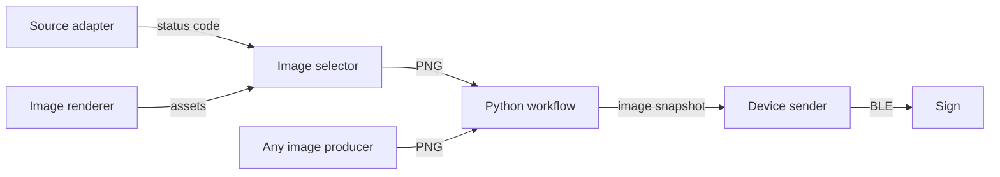
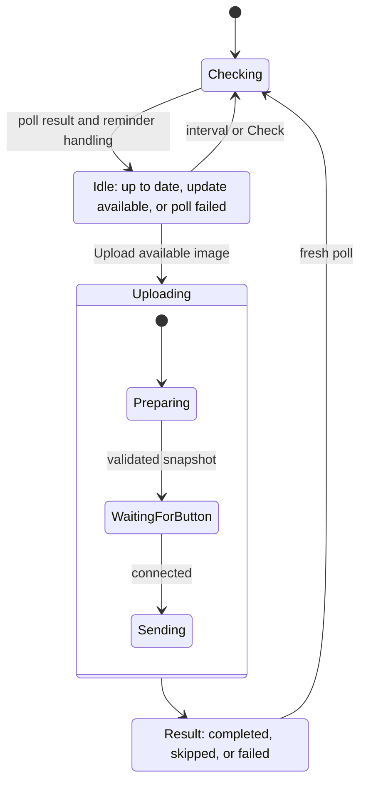
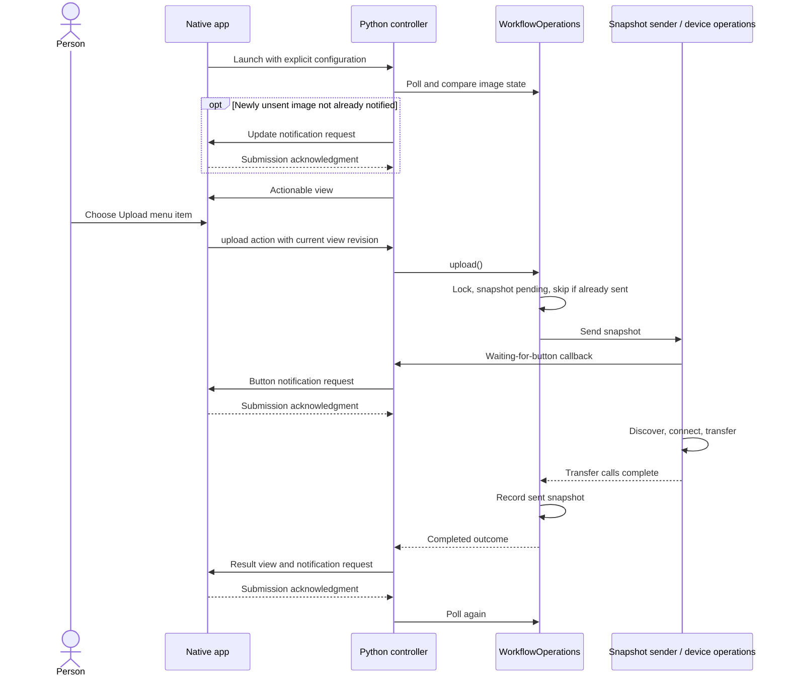

# Architecture

This is the conceptual model for the CLI and optional desktop app. See the [README](../README.md) for commands,
the [desktop guide](desktop-workflow.md) for setup, and the [desktop protocol](desktop-protocol.md) for JSON details.

## Composition and boundaries

| Component | Responsibility |
| --- | --- |
| Source adapter | Translate an external service into a status code. Currently [`mysign github status`](../README.md#view-and-match-github-status) adapts GitHub service health; classification policy is an explicit input. |
| Selector / renderer | Map a code to an existing image, or construct an image from explicit artwork, layout, and text. |
| Workflow | Validate desired images, compare and persist state, coordinate polling and manual uploads. |
| Device sender | Validate and encode an image, prompt for button wake, and transfer over BLE. |
| CLI | Parse arguments and delegate to domain operations with injected effects. |

Leaf commands do one operation and exit. [`mysign workflow watch`](../README.md#watch-in-a-terminal) and
[`mysign workflow desktop`](desktop-workflow.md) compose those operations into foreground loops. External scheduling
belongs to systemd, cron, or launchd; commands install no jobs.

## Stream contracts

1. Source adapters emit one status code and newline; selectors consume one code and emit the selected PNG's bytes.
2. Producers emit one complete static 1280 × 720 PNG, log to stderr, and exit zero.
3. Workflows pass producer arguments literally, without an implicit shell.
4. Producer-command mode checks exit status; piped image bytes cannot carry it.
5. Validate complete inputs before publication, output, button prompts, or Bluetooth discovery. Invalid data never
   implies a healthy source or replaces a valid image.
6. Data belongs on stdout; diagnostics, progress, and prompts belong on stderr. Nonzero exit indicates failure.

Command options and examples are in the [README](../README.md#composable-tools). Verified device behavior is in the
[BLE protocol](protocol.md).

## Workflow state

| Artifact | Meaning |
| --- | --- |
| `pending.png` | Latest complete desired image. |
| `last-sent.png` | Exact snapshot whose transfer calls last completed successfully. |

1. Publish changed pending images atomically. Failed producers preserve the previous image.
2. Snapshot pending before upload; skip when it matches last-sent.
3. Advance last-sent only after successful transfer calls. A newer pending image survives an older snapshot's transfer.
4. Completion records transfer calls, not confirmation of the physical display.
5. Use one state directory per sign, shared by every terminal and desktop invocation.
6. Separate poll and upload locks allow polling during a transfer while preventing overlapping instances of either operation.
7. Polling prepares images; uploading is an explicit foreground action.
8. Failed polls retain the last desired image for contextual manual upload. The terminal watcher waits for a successful
   poll before offering it again.

Defaults, overrides, and lock recovery are documented in the [workflow guide](../README.md#image-workflows).

## Desktop integration

| Component | Owns |
| --- | --- |
| Native macOS app | Menu, notification permissions and submission, diagnostic logs, Python child lifetime. |
| Python controller | Poll timing, reminder history, workflow state, and the existing snapshot uploader. |
| State machine | Immutable workflow facts and declarative event → state/effect decisions. |
| Protocol session | Versioned JSON records, notification acknowledgments, and view revisions. |

The native app owns one Python child. Polling and uploads run synchronously in that child; the native menu stays
responsive. Views project workflow state, and revision-matched actions prevent stale clicks from starting work.
The [transition table](../src/greg_mitchell/pwn_my_sign/desktop/machine.py) is the implementation source of truth.

## Desktop interaction

The diagram shows a successful upload of an unsent image. The terms refer to these contracts:

| Term | Meaning / source of truth |
| --- | --- |
| Upload | The menu command to send the pending image. [`WorkflowOperations.upload`](../src/greg_mitchell/pwn_my_sign/workflow/operations.py) owns locking, snapshot comparison, and recording success; [`SnapshotSender`](../src/greg_mitchell/pwn_my_sign/workflow/sender.py) delegates transfer to device operations. |
| Action | A native → Python JSON command (`upload` or `check`), defined by the [menu-action contract](desktop-protocol.md#menu-action). |
| View revision | The sequence number of a changed menu-state record. Actions echo it so stale clicks are rejected; see [View](desktop-protocol.md#view). |
| Reminder history | The last unsent image fingerprint whose update notification was accepted, persisted in `desktop-reminder.json` by [`ReminderStore`](../src/greg_mitchell/pwn_my_sign/desktop/reminders.py). It suppresses repeat reminders across polls and restarts; it does not mean the image was uploaded. |

The controller calls the workflow for both polling and uploading so terminal and desktop commands share image and
locking rules. Device callbacks let the controller supply the button notification during the workflow's upload.

1. Button-notification acknowledgment gates discovery. It establishes submission, not visible delivery; see
   [acknowledgments](desktop-protocol.md#acknowledgment) for failure behavior.
2. Persist a reminder fingerprint only after accepted submission; clear it when the desired image is already sent.
3. Poll immediately, then wait an interval after each completed check. Upload pauses polling; missed intervals are
   not replayed. Busy phases reject new workflow actions.
4. Quit and sleep cancel the child and wait for cleanup. Wake starts a replacement only after the previous child exits.
   Parent EOF prevents another poll. `desktop.lock` prevents duplicate controllers; locks are never removed automatically.
