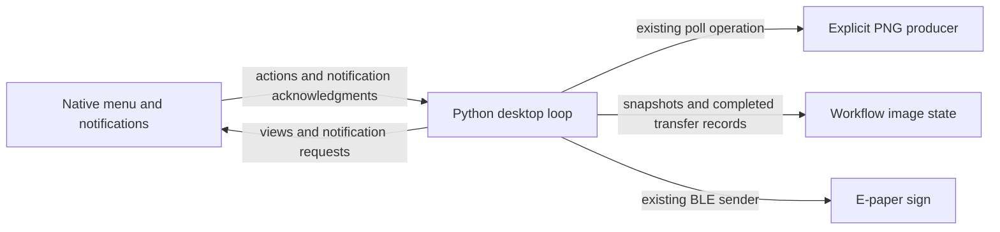
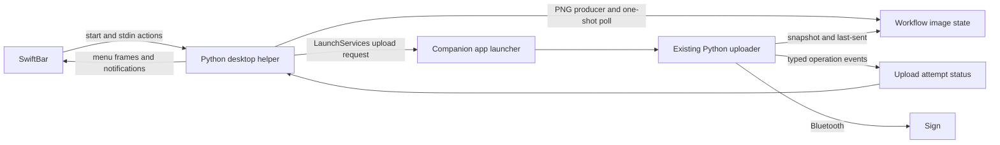

# Self-contained desktop workflow

Status: implemented; live hardware acceptance pending. The native decision supersedes the SwiftBar proposal below.

## Revised decision: one locally built menu bar app

On 2026-11-05 the user prioritized working notifications, simple setup, and local source builds without signing
infrastructure. A disposable Swift/AppKit application built with the installed command-line tools, ad hoc signed and
launched through LaunchServices, displayed notifications confirmed by the user, including a menu-triggered retry.
Its initial authorization callback returned a denial; subsequent settings reported authorized and submission succeeded.
That initial error was retained in the probe menu. Production must check current settings for each request and replace
old errors after successful retries; submission alone never proves that a banner appeared.

Use a small Swift/AppKit menu bar application with one Python `mysign workflow desktop --config FILE` child.
The app owns native menus, notification authorization/submission, a Test Notification action, bounded diagnostic logs,
and process lifetime. Python owns configuration, polling, reminder history, workflow state, and uploads. Existing
one-shot commands, snapshot semantics, and the verified BLE wire format remain authoritative.

This replaces the SwiftBar plugin and separate upload companion. Do not implement their menu stream format,
LaunchServices request files, independently surviving upload attempts, PID/status polling, or reattachment protocol.
The native parent itself supplies the app permission identity for its Python child. Real Bluetooth upload remains
an acceptance check; the earlier companion probe established scanning, not transfer completion.

### Process and notification contract

- Exchange bounded newline-delimited JSON records: versioned view updates, notification requests, matching
  acknowledgments, and user actions. Frozen Pydantic models own Python serialization; native types match the protocol.
- Use an injected single Python loop. Poll immediately, then wait the configured interval after poll completion.
  Polls and uploads are synchronous in that child; the native menu stays responsive and disables workflow actions
  while busy. Do not replay intervals missed during sleep or transfer.
- User actions identify the current view revision. Disable Upload immediately on click and reject stale buffered
  actions. Use one byte-framed input reader; buffered text readers combined with select can hide ready messages.
- Inject typed device boundaries after validation/before discovery and after connection. Before discovery emit the
  waiting view and button notification request, then wait a bounded time for the native app to confirm successful
  submission. Denial, EOF, or timeout prevents scanning. Acknowledgment means submission, never visible delivery.
- Retain one notified unsent-image fingerprint across ordinary restarts, clearing it when up to date. Failed polls
  show the error; retained images are available only through an explicitly contextual manual upload action.
- Completion follows successful last-sent publication and lock cleanup. Later notification failure cannot alter
  completed transfer state. Native notification requests recheck current settings, handle permission and submission
  errors, and explicitly request foreground banners using UserNotifications.

### Lifecycle and source builds

- A desktop-instance lock prevents duplicate or orphaned controllers; existing poll/upload locks retain their meanings.
  On startup briefly wait for a previous instance to unwind, without deleting its locks automatically.
- Normal Quit and sleep send SIGTERM to the child and wait asynchronously for cleanup. On wake wait for that child's
  actual exit before starting a replacement. Preserve existing producer-group termination and Bluetooth cleanup.
- A parent crash closes child stdin. Python exits on EOF before another poll and may first finish a running operation.
  A hung producer or forcibly killed process can leave locks; use existing manual stale-lock recovery.
- Build one `.app` under ignored `private/` using locally installed Apple command-line tools and automatic ad hoc
  signing. No Apple account, certificates, notarization service, or distribution pipeline is required for local builds.
  Use a fixed bundle identifier and app path; permission persistence after rebuilding is not guaranteed.
- The app depends on the checkout and synced venv. Configuration is explicit and private. Launch at login is an optional
  manual macOS setting; install no scheduler. Real upload, permission denial, rebuilds, and sleep during transfer remain
  live acceptance gates. Preserve normal terminal workflows.

### Implementation sequence

1. Add typed device upload boundaries and an explicit workflow upload outcome, preserving terminal behavior.
2. Add desktop configuration, JSON protocol, persistent reminders, controller/runtime, thin CLI, and behavioral tests.
3. Add the native menu/notification shell, reproducible local build, native tests, setup/recovery docs, and live smoke checks.

The units are serialized dependencies in a short review stack. Use injected dependencies, no subprocesses/threads/
network/Bluetooth in unit tests, and the repository's lint, strict type, and full test gates for each unit.

Implementation validation: lint, strict types, 711 Python tests, 70 native tests, and every pre-commit hook pass.
The real-process offline smoke covers polling, reminder deduplication, Check, an already-sent upload skip, parent EOF,
and lock cleanup. The locally built/signed app launched and its Python child polled the fixture successfully.
The installed app's visible notification check and the hardware/lifecycle checks above remain live acceptance gates.

## Superseded SwiftBar proposal and investigation

The following records the 2026-10-27 investigation with macOS 27.0.1 and SwiftBar 2.1.1, build 597. Its SwiftBar-specific
architecture is historical; the revised native decision above is authoritative.

## Purpose

Run the sign workflow from a persistent macOS menu bar icon, notify the user when an image needs uploading, and
prompt for the sign's physical button at the correct time. Routine operation requires neither a terminal window
nor a separately installed polling service.

The existing [workflow contracts](architecture.md#workflow-state) remain authoritative for image publication,
snapshots, upload locking, and recording completed transfers. Desktop integration supplies scheduling and presentation;
the existing producer, poller, and uploader continue to own their operations.

## Goals and non-goals

- Keep an icon visible while SwiftBar is running, with current workflow status in its menu.
- Poll immediately on startup and periodically afterward using an explicitly configured image producer.
- Offer an explicit Upload action and a desktop notification when the user should press the sign's button.
- Recover from ordinary producer and upload failures without restarting the plugin.
- Start and stop the integration through SwiftBar, with optional launch at login.

Automatic uploads, automatic stale-lock removal, dynamic card rendering, multiple-device UI, precise transfer
percentages, and a native menu bar application are outside the initial scope. Completion means transfer calls
completed; the protocol cannot confirm the physical display's image.

## Design decision

Use a SwiftBar [streamable plugin](#glossary) for the menu, periodic polling, and interactive control. Use a small
companion [application bundle](#glossary) to launch the existing Python uploader with its own Bluetooth permission identity.
Both components belong to one explicitly installed desktop integration; neither installs a launchd job.

Direct Bluetooth access from a Python plugin is unsuitable on the tested installation. A live scan terminated Python
with `SIGABRT`; macOS identified SwiftBar as the responsible application and reported its missing
`NSBluetoothAlwaysUsageDescription`. A companion app carrying that description successfully launched the same Python
environment and completed a scan, including when opened by the SwiftBar plugin. These findings establish the process
boundary, not a verified end-to-end upload. See [Investigation evidence](#investigation-evidence).

## User experience

The icon represents the workflow, not GitHub's health classification. The menu identifies the current operation and
whether desired content differs from the last completed transfer.

| State | Menu behavior |
| --- | --- |
| Starting or checking | Show that the producer is running. |
| Up to date | Show the most recent successful check. |
| Update available | Enable Upload and identify that an unsent image exists. |
| Preparing upload | Disable duplicate Upload actions while the companion starts and validates input. |
| Waiting for button | Show “Press the sign's button now.” |
| Sending | Show that transfer is active. |
| Poll failed | Show the error and last successful check; retain previous image state. |
| Upload failed or interrupted | Show the result and offer an explicit retry when no upload is active. |

Post one update-available notification for each newly observed unsent image. Retain the last notified image fingerprint
across ordinary helper restarts, clearing it when the workflow becomes up to date. Dismissing a notification does not
mark an image sent. Initial scope has no repeated reminders or snooze.

Upload is a menu action delivered to the running helper. It rechecks current state and invokes the existing snapshot
uploader. Only after input validation, immediately before Bluetooth discovery, post “Press the sign's button now.”
The current uploader's discovery timeout is 60 seconds. Missing that window produces a visible failure and leaves the
image available for manual retry; it does not cause repeated scans while the user is away.

Notifications carry no action that refreshes or restarts the plugin. The menu remains the control surface when
notifications are dismissed, disabled, or delayed by Focus. Show a completion or failure notification after an attempt,
and retain its result in the menu. SwiftBar's notification submission does not establish that a banner was visible.

Hide SwiftBar's built-in Run in Terminal action. Normal operation needs no keystroke automation or terminal-control
permission. Permission denial must produce a visible, actionable state rather than a claim of successful delivery.

## Components and interfaces

### Desktop helper

A thin `mysign workflow desktop --config FILE` entry point delegates to source modules outside `cli/`. Its explicit
configuration includes the producer argument tuple, working directory, device identifier, workflow state directory,
positive polling interval, and companion app location. Use frozen Pydantic models with explicit path resolution.

The plugin starts the checkout's existing executable using absolute paths and direct execution. Disable SwiftBar's
shell wrapper; do not depend on login-shell configuration or an activated environment. The probe inherited `/` as its
working directory. Producer stdin remains `/dev/null`; helper stdin is reserved for a closed set of menu actions.

Use one event loop with injected input, clock, workflow, app-launch, presentation, and notification dependencies.
Poll immediately, then wait for the configured interval after a completed poll. Pause source polling during an upload
attempt while continuing to service menu input and read attempt status. After the attempt finishes, poll again before
offering the next image. No concurrent producer or backlog of missed polling intervals is required.

Emit complete menu frames only when visible state changes, with explicit flushing and SwiftBar's documented leading
`~~~` delimiter. Render each frame into one string before writing it. Keep diagnostics on stderr and bound retained
local logs. SwiftBar retains stream output in memory in the inspected version, so avoid continuously
emitting identical menus, ticking timestamps, or detailed packet progress.

### Upload companion

The companion is an application bundle with a stable bundle identifier and Bluetooth usage description. A small native
launcher runs a thin one-shot Python desktop-upload entry point using the existing environment. Launch the bundle
through macOS [LaunchServices](#glossary), using `open`, rather than executing its internal binary as a child of SwiftBar. The latter
does not establish the permission boundary demonstrated by the probe.

An upload request identifies its attempt, workflow configuration, and state directory. The worker uses the existing
upload operation, including its lock, current pending snapshot, and last-sent comparison. Do not pass image bytes
through SwiftBar or infer success from the exit status of `open`.

Persist an atomic, typed attempt-status record containing an attempt identifier, monotonically increasing event
sequence, worker PID, phase, and optional error. The helper observes only the current attempt. Worker phases cover
preparing, waiting for button, sending, skipped, completed, failed, and interrupted. Add injected typed operation
callbacks at the validation/discovery and connection boundaries; do not parse English stderr messages. Preserve
existing CLI diagnostics and the verified BLE wire format.

At the discovery boundary, the worker publishes waiting-for-button and briefly waits for the helper to acknowledge
notification submission before scanning. The helper presents that phase and submits the notification through SwiftBar.
This acknowledgement means submission, not visible delivery. If the helper has stopped, fail preparation after a
bounded wait rather than scanning without a prompt or reopening SwiftBar. Later progress and result events need no
acknowledgement. After successful transfer calls and last-sent publication, record completion. Notification failure
must not turn a completed transfer into an upload failure or roll back last-sent.

### State and recovery

`pending.png`, `last-sent.png`, `poll.lock`, and `upload.lock` retain their current meanings. Add a desktop-instance lock
per workflow and keep reminder history and attempt status separate from those images. Existing terminal commands
remain usable against the same state directory.

An instance lock rejects a duplicate desktop helper. A newly started helper encountering a previous instance still
unwinding waits briefly before reporting contention. It never deletes a lock merely because it is old.

The companion is launched independently and may outlive a SwiftBar refresh, quit, or sleep transition. A replacement
helper first reconciles an active attempt and its upload lock, then resumes observation rather than launching another
upload. If the worker has exited without a terminal status, show an interrupted or unknown outcome. Retain the
last-sent record as the authoritative completed-transfer snapshot and use the documented stale-lock recovery process.
An active worker's lock prevents a retry; never infer successful transfer from a vanished process.

Retain the terminal watcher's stale-image rule: a failed poll does not automatically offer retained content as a fresh
update. The menu shows the poll failure. An explicit manual upload of retained content can remain available with that
context, matching the existing workflow's lack of an image-age gate.

## Lifecycle and installation

SwiftBar owns startup and process lifetime. The helper owns its repeat interval. Enabling SwiftBar's launch-at-login
option is the only optional login integration. Quitting or disabling SwiftBar stops future checks; a separately launched
upload attempt may finish and records its result for the next session.

SwiftBar 2.1.1 terminates plugins before sleep and starts them after wake. Startup therefore reconstructs state from
disk and performs one fresh check, or first observes an outstanding upload. It does not replay every missed interval.
Actual sleep during Bluetooth transfer remains a release gate in [Validation](#validation).

Catch expected polling, image, file, launch, and Bluetooth errors at their operation boundaries. SwiftBar does not
automatically restart a failed streamable process. Fatal failures use SwiftBar's error display and require explicit
plugin refresh; the integration is not a supervised daemon.

Install one executable plugin file with support files in an ignored or hidden support directory, including the built
companion app and explicit private configuration. Do not use SwiftBar's `.swiftbar` packaged-plugin format for this
version: its implementation explicitly ignores streamable metadata. Keep user artwork, device identifiers, and
generated app artifacts under ignored `private/`. The initial integration depends on the checkout and synced venv;
distributing a standalone Python runtime is outside scope.

Initial setup includes Bluetooth permission for the companion and notification permission for SwiftBar. Do not modify
SwiftBar's signed bundle or change the user's privacy settings automatically. Removal consists of disabling/removing
the plugin and its support files after active work finishes. It leaves image workflow state available to the CLI.

This feature requires a documented exception to the current
[external-scheduling boundary](architecture.md#composition-and-boundaries): the opt-in desktop helper repeats polls
while SwiftBar is running. It does not change one-shot command behavior or install a system scheduler.

## Investigation evidence

These are exploratory process and platform checks, not tests of an implemented desktop workflow.

| Check | Result |
| --- | --- |
| Direct SwiftBar execution | Live probe ran the existing venv's Python with nonterminal stdin and working directory `/`. |
| Menu icon | User screenshot confirms a persistent Sign probe menu bar item and Ready status. |
| Menu actions | After restarting with default leading stream delimiters, the user confirmed test items were visible. Probe logs record actual stdin `ping` and `notify` actions. |
| Recoverable error | Synthetic error was handled; the same process accepted a subsequent file-injected probe command. This did not verify menu-click delivery. |
| Refresh and quit | Probe recorded SIGTERM and cleanup; refresh started a new PID afterward. |
| Failed-process recovery | Direct Bluetooth scan caused SIGABRT; no automatic plugin restart occurred. Explicit refresh restarted it. |
| Notification submission | Real menu click reached the notifier and URL submission returned zero. An early authorization request errored; a later request logged authorization granted and submission without error. The user reports notifications enabled but no visible notification. |
| Direct Bluetooth | Crash report names SwiftBar as responsible process and identifies the missing usage-description key. No connection was attempted. |
| Companion Bluetooth | Temporary bundle with the usage description launched the same venv and completed a three-second scan. Repeat launch from SwiftBar also completed without connecting. |
| Sleep and wake | Source inspection confirms terminate/start hooks. Real sleep/wake, including interrupted transfer, was not exercised. |
| Existing checks | `uv run poe check-all` passed lint, type checking, and all 584 tests. |

The probe and logs are retained locally under ignored `private/review/desktop-swiftbar-20261027/`. The companion scan
used a locally compiled launcher, not a signed distribution build. Existing privacy grants may affect permission prompts;
fresh-install grant, denial, and subsequent-launch behavior remain unverified. No image was uploaded and no scheduler
was installed. The user's terminal-debug action required permissions; those are not dependencies of this design.

## Validation

Unit coverage uses injected dependencies and fakes, with no subprocesses, Bluetooth, threads, real waits, or patching.
Cover startup reconstruction, notification deduplication, failed-poll presentation, menu-action dispatch, duplicate
uploads, typed event ordering, failed launch, missing worker result, and restart during an active attempt. Preserve
existing snapshot and publication behavior tests.

Before enabling the real workflow, complete live acceptance with the installed SwiftBar version:

- Render every menu state and confirm Upload reaches the helper through stdin.
- Confirm visible notifications with authorization granted, and useful menu behavior with authorization denied.
- Verify companion Bluetooth grant and denial, then perform one real upload with correct button-prompt timing.
- Confirm a newer pending image survives an older snapshot's transfer and repeated clicks do not duplicate uploads.
- Exercise refresh, disable, quit, sleep/wake, and worker termination during an attempt; inspect locks and last-sent.
- Verify launch at login, explicit paths, environment recreation, and uninstall behavior.

Visible notification delivery is an acceptance blocker. Menu-click delivery is verified with the default stream format.
The successful scan removes the direct-launch privacy blocker for the tested companion process topology; it does not
establish end-to-end desktop readiness.

## Alternatives considered

| Alternative | Reason for rejection |
| --- | --- |
| Standard plugin plus launchd polling | Requires a second lifecycle and a separately installed service for a self-contained desktop experience. |
| Standard plugin owns polling and upload in each refresh | Long uploads occupy a refresh; responsive status and user actions still need a separate worker and coordination. |
| Python streamable plugin uploads directly | Reproduced macOS privacy abort under the installed SwiftBar bundle. |
| Modify or re-sign SwiftBar with a Bluetooth description | Changes a third-party app and creates update and signing maintenance. |
| Terminal upload or terminal-notifier wrapper | Requires a terminal UI or another notification dependency without providing the persistent menu surface. |
| Native menu bar app | Reimplements UI and plugin hosting already supplied by SwiftBar. The companion only supplies a permission boundary. |
| Optional trailing stream delimiters | The initial probe omitted custom menu actions; the documented leading-delimiter format worked after restart. The exact cause was not isolated, so use the demonstrated format. |

## Open questions

- Why are authorized notifications not visibly presented on this installation? Test background delivery separately from
  menu-click delivery. The inspected SwiftBar delegate has no foreground-presentation handler, which is a hypothesis
  for menu-triggered suppression, not an established root cause.
- What signing and installation location provide stable companion permission identity across local rebuilds?
- During a real sleep transition, does an active uploader unwind promptly or resume with a transport failure?
  The result determines the precise interrupted-attempt message and recovery guidance.

## Glossary

- Streamable plugin: a long-running executable whose stdout updates SwiftBar's menu and whose stdin receives actions.
- Application bundle: a macOS `.app` directory containing an executable and identity/permission metadata in `Info.plist`.
- LaunchServices: macOS application launching, used here through `open` to start the companion as an application.
- TCC: macOS privacy enforcement, which attributes protected resource access to a responsible application.

## References

- [SwiftBar v2.1.1 stream handling and stdin](https://github.com/swiftbar/SwiftBar/blob/v2.1.1/SwiftBar/Plugin/StreamablePlugin.swift).
- [SwiftBar v2.1.1 sleep/wake and notification handling](https://github.com/swiftbar/SwiftBar/blob/v2.1.1/SwiftBar/AppDelegate.swift).
- [SwiftBar v2.1.1 notification submission](https://github.com/swiftbar/SwiftBar/blob/v2.1.1/SwiftBar/Plugin/PluginManger.swift).
- [SwiftBar v2.1.1 packaged-plugin limitation](https://github.com/swiftbar/SwiftBar/blob/v2.1.1/SwiftBar/Plugin/PackagedPlugin.swift).
- [Bleak macOS permission requirements](https://bleak.readthedocs.io/en/stable/backends/macos.html#permissions).
- [Bleak missing-usage-description crash](https://bleak.readthedocs.io/en/stable/troubleshooting.html#bleak-crashes-with-sigabrt-on-macos).
- [Apple foreground notification presentation](https://developer.apple.com/documentation/usernotifications/unusernotificationcenterdelegate/usernotificationcenter(_:willpresent:withcompletionhandler:)).
