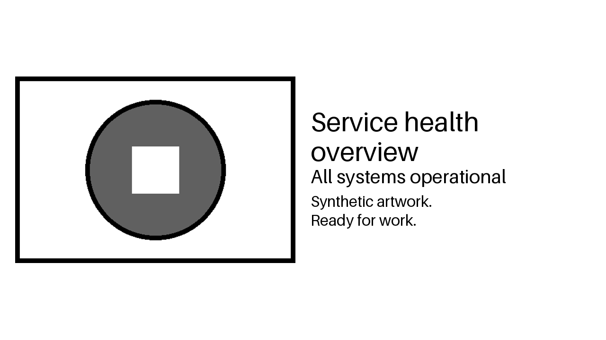
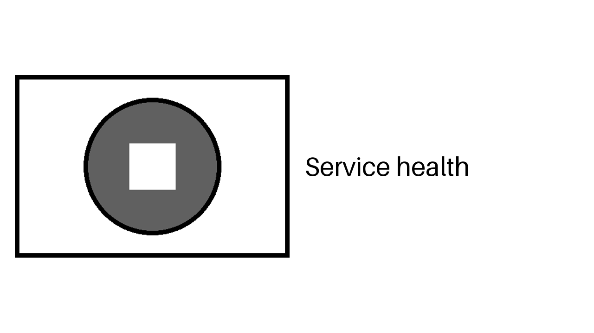
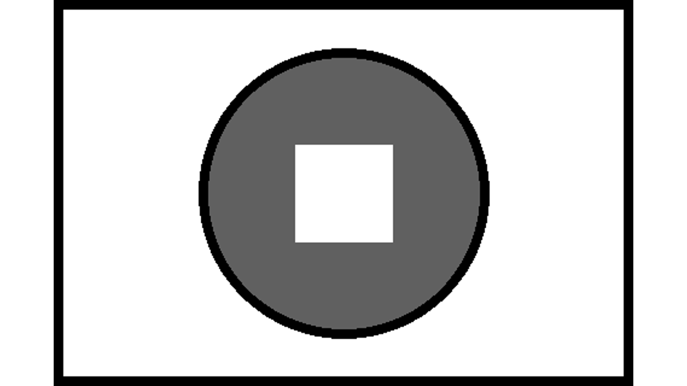
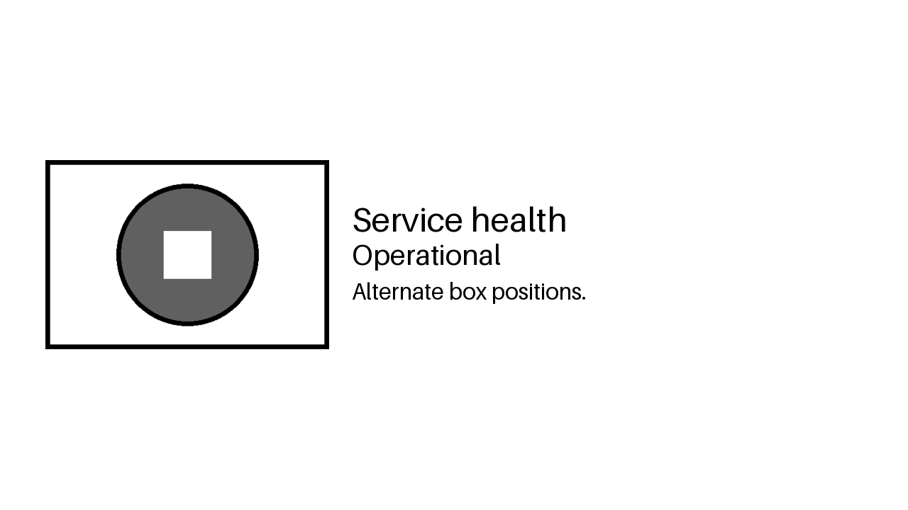

# Synthetic fixtures

## GitHub summary examples

`github/*.json` are hand-written summary documents for offline status simulations.
Only the Actions component ID is a real API identifier; other IDs and service combinations are schematic.
No live API responses, incidents, device identities, or private assets are included.

The [static GitHub Actions policy](../../data/github-actions.toml) explicitly sets all service settings and output codes.
The scenarios below are tested using that same file; personal settings stay outside tracked examples.

| File | Example service policy |
| --- | --- |
| `github/healthy.json` | `ok` |
| `github/actions-only.json` | `actions-outage`, despite a critical rollup and unrelated degradation |
| `github/unrelated-outage.json` | `degraded` |
| `github/simultaneous-outages.json` | `widespread-outage`, including Actions |
| `github/widespread-outages.json` | `widespread-outage`, excluding Actions |
| `github/maintenance.json` | `degraded`, with active scheduled maintenance |

Run a simulation from the project root:

```sh
uv run mysign github status --policy data/github-actions.toml \
  --input tests/fixtures/github/actions-only.json
```

## Image fixtures

`grayscale.frame.gz` and `checkerboard.frame.gz` are independently constructed
460,800-byte wire-format patterns. Both carry asymmetric corner values so pixel
direction can be checked. They contain no app pixels, fonts, artwork, device
identity, HCI metadata, or Android diagnostics.

The payloads omit the separate `!I` command and use deterministic gzip storage.
Regenerate them from the project root:

```sh
uv run python scripts/generate_test_fixtures.py
```

The generator constructs bytes directly without importing the project encoder.
Original captured TEST A / TEST B images remain private. See [the protocol](../../docs/protocol.md)
for the observations that established the format.

## Rendered card examples

These checked-in grayscale PNGs use only schematic shapes drawn by the fixture generator and text rendered with
Pillow's bundled Aileron Regular test font. They contain no user artwork or redistributed font files.
The generator calls the real card renderer with the explicit layouts below; these are visual review artifacts,
not byte-for-byte snapshots across dependency upgrades.

Regenerate from the project root:

```sh
uv run python scripts/generate_card_fixtures.py
```

Identical inputs produce identical bytes within the same Pillow/font rasterizer environment.
These examples were generated with Pillow 12.3.0; Pillow, FreeType, or bundled font changes can change rendering.
Tests check the rendered sign format and layout behavior rather than enforcing cross-version PNG byte equality.

### Split layout with wrapped text

Uses [card-layout.toml](../../data/card-layout.toml) with centered artwork and complete text stack, title `Service health overview`, status
`All systems operational`, and caption `Synthetic artwork.` followed by `Ready for work.` on a new line.



### Title only

Uses the same split layout with title `Service health` and omitted status/caption.



### Artwork only

Uses [artwork-layout.toml](../../data/artwork-layout.toml) with no text region or visible text.
The artwork reaches the top and bottom canvas edges; no margin is imposed on artwork.



### Alternate geometry

Uses a 400 × 592 artwork box at (64, 64) and a 720 × 592 text box at (496, 64), both vertically centered.
The title is 48 pixels; the status and caption retain the split layout's 40- and 32-pixel sizes.
Text is `Service health`, `Operational`, and `Alternate box positions.`.


